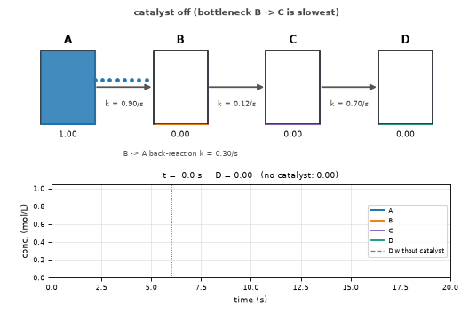
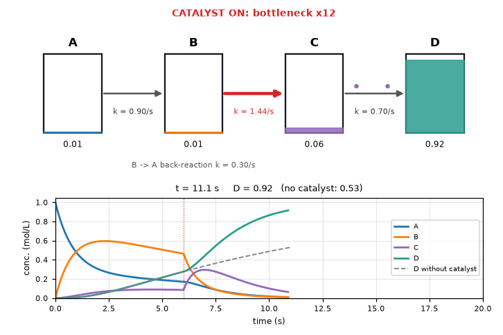
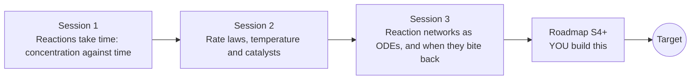

# openreactionrate

[](https://github.com/KrunalPanchal1995/openreactionrate/actions/workflows/ci.yml)   [](https://colab.research.google.com/github/KrunalPanchal1995/openreactionrate/blob/main/sessions/session-01/lesson.ipynb) [](https://krunalpanchal1995.github.io/openreactionrate/)

**Write reaction networks as equations and watch catalysts speed them up, in three sessions.**

openreactionrate teaches chemical kinetics from a single concentration-time curve to reaction networks solved as ODEs with your own Runge-Kutta code, using only Python and a browser.

- **Start from zero.** Session 1 needs only school algebra and the idea of a graph; every symbol is explained.
- **See it move.** Every session ships a slider app that runs in the browser, with a catalyst switch and labelled graphs.
- **Know you got it right.** Each session ends with a checkpoint that prints PASS or FAIL against hand calculations and exact solutions.
- **Build the missing half.** The repo stops at Session 3 on purpose; the roadmap shows the path to the Target.

[Target](#the-target) · [Who is this for](#who-is-this-for) · [Quick start](#quick-start) · [Sessions](#sessions) · [Roadmap](#roadmap) · [Contribute](#contribute) · [Explainer PDF](docs/explainer.pdf)

> **This repo is incomplete on purpose.** Sessions 1 to 3 are here and fully working. The finished Target below is a preview of what the community can build next. We show you the path, not the code. Sessions 4 and up are yours.

## The Target

A network of four tanks, A <-> B -> C -> D, with dots flowing along the pipes and a live concentration-time plot underneath. For the first 6 seconds the slowest step (B -> C) holds everything back and the product D creeps up. Then a catalyst is switched on at that bottleneck step, making it 12 times faster: C is drained, D shoots up, and the dashed curve shows how little D you would have without the catalyst. Your goal over the coming sessions: build that network simulator yourself, with a catalyst switch that you can aim at any step.



*Target: a catalyst switched on at the bottleneck step of A <-> B -> C -> D*



*Target, one frame: tanks, flowing dots and the live concentration-time plot*

Try it live:

- [Math Visual Studio: collision theory and reaction dynamics (Atlas S112)](https://krunalpanchal1995.github.io/studio/#atlas?ch=S112&ex=1)
- [Math Visual Studio: ordinary differential equations (Atlas S16)](https://krunalpanchal1995.github.io/studio/#atlas?ch=S16&ex=1)

How the Target was made is shown only as a path in [promo/roadmap.md](promo/roadmap.md).

## Who is this for
**secondary school to diploma / undergraduate (levels 3-5).** Topic area: Chemistry and Materials Science.

Prerequisites:

- School algebra, the exponential function and the natural logarithm (a calculator is enough).
- Python 3.10 or newer; if `python --version` works, you are ready. PRIMER.md explains the rest.
- No prior chemistry kinetics, GitHub or differential equations experience is needed.

New to Python? Read [PRIMER.md](PRIMER.md) first (10 minutes).

## Quick start

No installation knowledge needed. You need [Git](https://git-scm.com/downloads) and [Python 3.10+](https://www.python.org/downloads/) (Windows: tick "Add Python to PATH"). On Mac and Linux type `python3` wherever this page says `python`.

```bash
git clone https://github.com/KrunalPanchal1995/openreactionrate.git
cd openreactionrate
python start.py 1
```

`start.py` creates a private environment, installs what is needed and runs Session 1 with its checkpoint. Next: `python start.py 2`, `python start.py 3`, or `python start.py test` to check everything. Only a checkpoint: `python start.py check 1`.

Four lines turn the idea of Session 1 into a result (they work as they are): Save it as `try.py` and run it with `python start.py run try.py` (this uses the private environment, where NumPy is installed):

```python
import numpy as np
k, A0 = 0.10, 1.0                      # rate constant (1/s), starting concentration (mol/L)
print(round(float(A0 * np.exp(-k * 10)), 3))     # -> 0.368  A left after 10 s
print(round(float(np.log(2) / k), 2))            # -> 6.93   half-life in seconds
```

Every session also opens in your browser with sliders (no install): [live apps](https://krunalpanchal1995.github.io/openreactionrate/). Or use the Colab badge above for the notebook.

## Sessions

| # | Session | Model level | Time | Live app |
|---|---|---|---|---|
| 1 | [Reactions take time: concentration against time](sessions/session-01/README.md) | Level 1: conceptual interactive model | 60 min | [open](https://krunalpanchal1995.github.io/openreactionrate/session-01/) |
| 2 | [Rate laws, temperature and catalysts](sessions/session-02/README.md) | Level 2: mathematical engineering model | 75 min | [open](https://krunalpanchal1995.github.io/openreactionrate/session-02/) |
| 3 | [Reaction networks as ODEs, and when they bite back](sessions/session-03/README.md) | Level 3: simulation and validation | 90 min | [open](https://krunalpanchal1995.github.io/openreactionrate/session-03/) |

Each session follows the same six steps: A real-world problem, B concept and theory, C visual explanation, D interactive simulation, E worked example and experiment, F assessment and design challenge. Each ends with `checkpoint.py`, which prints `PASS` or `FAIL` against reference numbers. Session 3 also contains the real-world mini-project: **Which step should the catalyst speed up?**.

## Architecture



| Folder or file | What is inside |
|---|---|
| `sessions/` | three sessions: README (A-F), `lesson.py`, notebook, live app, exercises, activity sheet, checkpoint |
| `promo/` | the Target: media, live links, and the roadmap (path only) |
| `docs/` | `explainer.tex` and the built `explainer.pdf` |
| `tests/` | runs every lesson and checkpoint headless |
| `start.py` | one command to set up and run anything |
| `QUALITY.md`, `RUBRIC.md` | the quality checklist and the scoring rubric |
| `.github/` | CI, PDF build, Pages deploy, issue and PR templates |

## Roadmap

| Milestone | What you will build | Difficulty |
|---|---|---|
| Session 4: Temperature-dependent networks | A network simulator in which every step has an activation energy and the temperature is an input. | intermediate |
| Session 5: Fit rate constants from noisy data | A fitting routine that recovers k1 and k2 of A -> B -> C from synthetic data. | intermediate |
| Session 6: Heat of reaction: exothermic and endothermic | An adiabatic reactor in which the heat released changes k, with the catalyst as a switch. | advanced |
| Session 7: An implicit solver for stiff nonlinear networks | A stiff solver that handles the enzyme cycle with k1 = 1e6 L/(mol s). | advanced |
| Session 8: Oscillating reactions | A Brusselator simulation with a stability picture. | advanced |

Full detail with a checkpoint per milestone: [promo/roadmap.md](promo/roadmap.md).

## Contribute
New to GitHub? Read [CONTRIBUTING.md](CONTRIBUTING.md); it starts from zero. Pick an issue labelled `good first issue`. Translations into Hindi, Telugu, Tamil and Malayalam are welcome.

<details>
<summary>Development</summary>

```bash
python start.py test        # runs every lesson and checkpoint
```
Lessons use `# %%` cell markers so they open as notebooks in VS Code. See [QUALITY.md](QUALITY.md) for the standard every session meets.
</details>

## License
MIT. See [LICENSE](LICENSE). Media in `promo/media` is (c) Krunal Panchal, CC BY 4.0.

## Acknowledgments
Part of the [PAN IIT OSS](https://hellofoss.tech-iitb.org/projects) open-source teaching collection, modelled on the structure of [openspline](https://github.com/openspline/openspline). Built on ideas from the Math Visual Studio at https://krunalpanchal1995.github.io/studio/.
