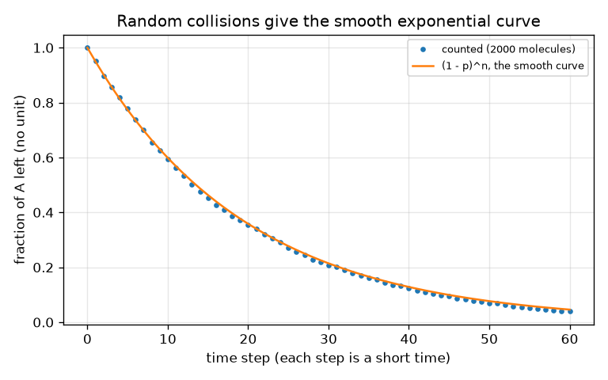

# Session 1: Reactions take time: concentration against time

*Level 1 (conceptual interactive model) · about 60 minutes · openreactionrate*

> This is a simplified educational model. It is not a validated design tool and must not be used for real structures, electrical installations, vehicles, industrial processes or medical decisions.

**Prerequisites**

- School algebra and reading a graph.
- You have read PRIMER.md and run `python start.py 1` once.

**Learning objectives.** After this session you can:

- Say what a reaction rate is and name four things that change it: concentration, temperature, collisions and a catalyst.
- Read a concentration-versus-time curve for A -> B and find the half-life from it.
- Use [A] = A0 exp(-k t) and half-life = ln 2 / k with the right units.
- Explain why the curve bends, using the idea of random collisions.

## A. Real-world problem
Milk sours in a day on the kitchen table and in a week in the fridge. A bottle of hydrogen peroxide keeps for months, but a pinch of manganese dioxide makes it fizz at once. Chemical reactions take time, and some things (warmth, more molecules in the same space, a catalyst) change how much time. How can we draw, and then predict, how fast a substance A turns into a substance B?

## B. Concept and theory
For a molecule of A to turn into B it usually has to collide with something, and the collision must be energetic enough. If there are more A molecules in the same volume (a higher concentration) there are more collisions per second, so the rate is bigger. In the simplest reaction A -> B the rate (how many mol/L of A disappear per second) is proportional to the concentration of A: rate = k [A]. The constant k is the rate constant; a big k means a fast reaction. Warming the mixture makes collisions more frequent and, much more importantly, more energetic, so k grows. A catalyst gives the reaction an easier route, which also raises k, and it is not used up. Solving rate = k [A] gives an exponential decay: [A] falls fast at first, when there is a lot of A, and then more slowly. The half-life is the time for [A] to halve; for this reaction it is the same wherever you start. B is simply what A has lost, [B] = A0 - [A]. Here the catalyst is modelled in the simplest way, as a factor f that multiplies k.

| Symbol | Meaning | Unit |
|---|---|---|
| [A] | concentration of A at time t | mol/L |
| A0 | starting concentration of A | mol/L |
| k | rate constant (for A -> B) | 1/s |
| t | time | s |
| t_half | half-life: time for [A] to halve | s |
| f | catalyst speed-up factor (k is multiplied by f) | no unit |

**Assumptions**

- One step A -> B only, and it cannot go backwards.
- Temperature stays constant while the reaction runs.
- The mixture is stirred, so the concentration is the same everywhere.
- A catalyst only multiplies k; real catalysts can also be poisoned or used up slowly.

$$ \text{rate}=-\frac{d[A]}{dt}=k\,[A] $$

$$ [A]_t=A_0\,e^{-kt},\qquad [B]_t=A_0-[A]_t $$

$$ t_{1/2}=\frac{\ln 2}{k},\qquad t_{x}=\frac{1}{k}\ln\frac{1}{1-x}\ \ (\text{time to convert a fraction }x) $$

## C. Visual explanation
The first figure plots [A] and [B] against time for k = 0.10 1/s (solid) and for a catalyst that makes k five times bigger (dashed). The two A curves have the same shape; the dashed one is simply squeezed to one fifth of the time, and the half-life drops from 6.9 s to 1.4 s. A and B cross at the half-life, where each is half of the start. The second figure counts 2000 molecules, each with a 5 percent chance per time step of reacting: the dots lie on the smooth curve (1 - p)^n, so the bending of the curve needs no special rule, only fewer A molecules left to react.

![[A] and [B] for A -> B; the 5 times catalyst (dashed) squeezes the same curve into one fifth of the time.](../../docs/figures/s01_a_to_b.png)

*[A] and [B] for A -> B; the 5 times catalyst (dashed) squeezes the same curve into one fifth of the time.*

*Counting 2000 molecules that react at random reproduces the smooth exponential curve.*

## D. Interactive simulation
Run the lesson (`python start.py 1`), then open the live app: [Session 1: A -> B with a catalyst](https://krunalpanchal1995.github.io/openreactionrate/session-01/) (or `app.html` in this folder). Drag the time slider and watch the tanks: A empties while B fills, and the sum stays the same. Then raise the catalyst factor and see the same curve play out faster. Switch to the graph view and find where the blue and green curves cross.

**Challenge.** Make half of A react within 5 seconds (half-life below 5 s).

## E. Worked example and experiment
**Problem.** For A -> B with k = 0.10 1/s and A0 = 1.0 mol/L, find [A] and [B] after 10 s, the half-life, and the time to convert 90 percent. Then see what a catalyst that makes k five times larger does to the last number.

1. [A] after 10 s: k t = 0.10 * 10 = 1.0, so [A] = 1.0 * exp(-1.0) = 0.368 mol/L.
2. [B] = A0 - [A] = 1.0 - 0.368 = 0.632 mol/L. (Check: A + B = 1.000 mol/L.)
3. Half-life = ln 2 / k = 0.693 / 0.10 = 6.93 s.
4. 90 percent converted means [A] = 0.10: t = ln(10) / k = 2.303 / 0.10 = 23.0 s.
5. With the catalyst k = 0.50 1/s, so the time is 2.303 / 0.50 = 4.6 s: five times sooner.

**Answer.** [A] = 0.368 mol/L and [B] = 0.632 mol/L after 10 s; half-life 6.93 s; 90 percent after 23.0 s, or 4.6 s with the 5 times catalyst.

**Experiment.** Drop an effervescent tablet into 200 mL of cold tap water (about 10 degrees C) and into 200 mL of warm water (about 40 degrees C) and time how long the fizzing takes to stop; try a half tablet as well. The warm water should finish clearly sooner. Model versus reality: a tablet dissolving is not a clean first-order reaction (the surface area shrinks, stirring matters), and temperature changes k by a certain factor rather than 'a little'. Treat the experiment as a picture of the trend, not a check of the number. Do not drink the solutions and follow the label.

## F. Assessment and design challenge
**Question type A: Conceptual.** Why does the concentration of A fall quickly at first and slowly later, even though nothing about the reaction changes?

Hint

What does the rate depend on, and what happens to that quantity as time goes on?

Step-by-step solution

The rate is k [A]. At the start there is a lot of A, so many reactions happen per second. As A is used up there are fewer A molecules and fewer collisions, so the rate falls and the curve flattens. The rate constant k itself is unchanged; the rate falls only because [A] falls.

**Question type B: Numerical.** A reaction A -> B has k = 0.05 1/s and A0 = 2.0 mol/L. Find [A] after 20 s and the half-life, and check your answer for sense.

Hint

k t = 1 after 20 s. Use [A] = A0 exp(-k t) and t_half = ln 2 / k.

Step-by-step solution

[A] = 2.0 * exp(-1) = 0.736 mol/L. Half-life = 0.693 / 0.05 = 13.9 s. Sense check: 20 s is about 1.44 half-lives, so [A] should be 2.0 * 0.5^1.44 = 0.736. They agree. Units: concentration in mol/L, k in 1/s.

**Question type C: Graph and simulation interpretation.** On the A-B graph of the slider app (A0 = 1, k = 0.10), where do the curves cross and what value do they have there? What would change if A0 were 2?

Hint

They cross when [A] = [B], that is when exactly half of A has reacted.

Step-by-step solution

They cross at the half-life, 6.9 s, at the value 0.5 mol/L (half of A0). With A0 = 2 they would cross at the same time, 6.9 s, but at 1.0 mol/L, because the half-life of this reaction does not depend on the starting concentration.

**Question type D: Design and optimisation challenge.** Design: a reaction with k = 0.10 1/s must be 90 percent complete within 10 s. By what factor must a catalyst raise k? Which whole-number factor would you choose, and what other things besides speed matter?

Hint

Solve ln(10) / k_new = 10 s for k_new, then divide by 0.10.

Step-by-step solution

k_new = ln(10) / 10 = 0.230 1/s, a factor of 2.3. The next whole number is 3, giving k = 0.30 1/s and a time of 7.7 s with some margin. Other things that matter: cost of the catalyst, whether it can be separated from the product, whether it is poisoned or used up, whether the product is safe, and whether the reaction releases heat that must be removed.

Score yourself with [RUBRIC.md](../../RUBRIC.md). Print the [activity sheet](activity_sheet.md) to work on paper.

## Common misconceptions
| Common misconception | What is actually true |
|---|---|
| A catalyst is used up and becomes part of the product. | A catalyst is not consumed overall: it takes part in the steps but is regenerated, so a little of it speeds up a lot of reaction. |
| A reaction with twice the rate constant converts twice as much in the same time. | Twice the k means the same fraction is reached in half the time, but the amount converted after a fixed time follows an exponential, not a straight line. |
| A reaction stops when the concentration reaches zero in a finite time. | For A -> B with rate k [A] the concentration only approaches zero; each half-life halves what is left. |
| A catalyst changes how much product you finally get. | A catalyst changes the speed, not where the reaction ends up (for a reaction that goes to completion, the same amount of B). |

## Glossary
- **rate constant (k)**: a number that sets how fast a given reaction goes; larger means faster
- **concentration**: amount of substance per litre, in mol/L
- **half-life**: the time for a concentration to fall to half
- **catalyst**: a substance that speeds up a reaction and is regenerated
- **collision**: two molecules meeting; the reaction can happen only if they meet

## Finish
1. Do the three coding tasks in [exercises.md](exercises.md).
2. Run `python start.py 1` again after your changes. It ends with the checkpoint; when it prints `PASS`, you are done. (Checkpoint only: `python start.py check 1`.)

Next: [Session 2](../session-02/README.md)
