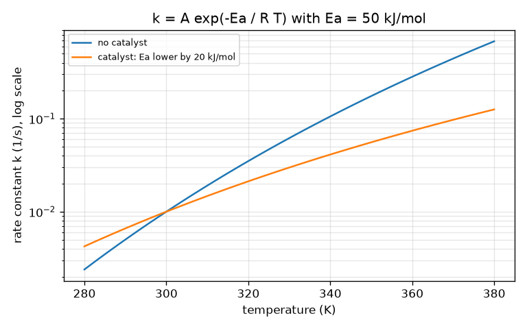

# Session 2: Rate laws, temperature and catalysts

*Level 2 (mathematical engineering model) · about 75 minutes · openreactionrate*

> This is a simplified educational model. It is not a validated design tool and must not be used for real structures, electrical installations, vehicles, industrial processes or medical decisions.

**Prerequisites**

- Session 1: the A -> B curve, k and half-life.
- Natural logarithm and exponential (calculator).

**Learning objectives.** After this session you can:

- Use rate = k [A]^n for first and second order and solve for [A] and the half-life.
- Tell first order from second order by which plot is straight: ln[A] or 1/[A] against time.
- Use the Arrhenius form k = A exp(-Ea / R T) to compare rate constants at two temperatures.
- Compute how much a catalyst that lowers Ea by 20 kJ/mol speeds a reaction at 300 K, and solve a design problem for the time to 90 percent conversion.

## A. Real-world problem
Someone has to decide how long a reaction must run, at what temperature, and whether a catalyst is worth it. For that we need an equation for the rate, a way to tell from measurements what kind of reaction it is, and the effect of temperature and of a catalyst on k. A common rule of thumb says 'a reaction goes about twice as fast for every 10 degrees warmer'. Is that rule right, and what does a catalyst do compared with warming? (General education only: real process design needs measured data and a safety review.)

## B. Concept and theory
A rate law says how the rate depends on concentration: rate = k [A]^n. The exponent n is the order, found from experiments, not from the equation of the reaction. For n = 1 the half-life ln 2 / k does not depend on the start; for n = 2 the half-life is 1 / (k A0) and gets longer as A is used up. You can read the order from data by choosing the plot that gives a straight line: ln[A] against t for first order (slope -k), 1/[A] against t for second order (slope +k). Temperature enters through k. Only collisions with energy above the activation energy Ea can react, and the share of such collisions grows steeply with temperature: k = A exp(-Ea / R T), the Arrhenius form (R = 8.314 J/(mol K), T in kelvin, A the pre-exponential factor with the units of k). Comparing two temperatures, A cancels: k(T2)/k(T1) = exp(-Ea/R (1/T2 - 1/T1)). A catalyst gives another route with a lower activation energy, Ea - dEa, so at the same temperature k is multiplied by exp(dEa / (R T)). Because Ea sits in an exponent, a modest drop gives a huge speed-up. Whether a reaction releases heat (exothermic: the products sit lower in energy than the reactants) or absorbs heat (endothermic: higher) is a separate matter from how high the barrier is. Estimating Ea carefully from measured data is the job of the openarrhenius repo.

| Symbol | Meaning | Unit |
|---|---|---|
| n | order of the reaction | no unit |
| k | rate constant | 1/s (n = 1), L/(mol s) (n = 2) |
| A0, [A] | starting and current concentration | mol/L |
| Ea | activation energy | J/mol |
| R | gas constant, 8.314 | J/(mol K) |
| T | absolute temperature | K |
| dEa | drop in activation energy caused by a catalyst | J/mol |
| x | fraction converted (0 to 1) | no unit |

**Assumptions**

- A single step with rate law rate = k [A]^n, n = 1 or 2.
- Ea and the pre-exponential factor do not change over the temperature range used.
- The catalyst lowers Ea and leaves the pre-exponential factor unchanged.
- The reaction goes to completion (no back reaction) and heat release is ignored.

$$ [A]_t=A_0e^{-kt}\ (n=1),\qquad t_{1/2}=\frac{\ln 2}{k} $$

$$ [A]_t=\frac{A_0}{1+kA_0t}\ (n=2),\qquad t_{1/2}=\frac{1}{kA_0} $$

$$ \ln[A]=\ln A_0-kt\ (n=1),\qquad \frac{1}{[A]}=\frac{1}{A_0}+kt\ (n=2) $$

$$ k=A\,e^{-E_a/(RT)},\qquad \frac{k(T_2)}{k(T_1)}=\exp\!\left[-\frac{E_a}{R}\left(\frac1{T_2}-\frac1{T_1}\right)\right] $$

$$ \frac{k_{\text{cat}}}{k}=\exp\!\left(\frac{\Delta E_a}{RT}\right),\qquad t_{x}=\frac1k\ln\frac{1}{1-x}\ (n=1),\quad t_x=\frac{x}{kA_0(1-x)}\ (n=2) $$

## C. Visual explanation
The first figure shows [A] against time for first and second order with the same numbers (k = 0.03): the second-order curve starts alike but has a long tail. Next to it, ln[A] is straight for first order and curved for second order, and 1/[A] is straight for second order and curved for first order. The second figure plots k against temperature on a log scale for Ea = 50 kJ/mol, with and without a catalyst that lowers Ea by 20 kJ/mol: the catalysed line lies about 3000 times higher at 300 K, and the gap shrinks at higher temperature because dEa/(R T) gets smaller.

*Rate constant against temperature on a log scale: lowering Ea by 20 kJ/mol moves the line up by about 3000 times at 300 K.*

![First and second order give different [A] curves; only the right transformation (ln[A] or 1/[A]) is a straight line.](../../docs/figures/s02_orders_and_lines.png)

*First and second order give different [A] curves; only the right transformation (ln[A] or 1/[A]) is a straight line.*

## D. Interactive simulation
Run the lesson (`python start.py 2`), then open the live app: [Session 2: orders, temperature and catalyst](https://krunalpanchal1995.github.io/openreactionrate/session-02/) (or `app.html` in this folder). Choose first or second order and watch the three plots: only one of ln[A] and 1/[A] is a straight line. Warm the mixture and lower the barrier with the catalyst slider; the energy-barrier view shows the sketch, the readout shows the factors.

**Challenge.** With first-order kinetics, make 90 percent conversion take less than 30 s (it takes 115 s at the default settings).

## E. Worked example and experiment
**Problem.** A first-order reaction has k = 0.02 1/s at 300 K. How long does it take to convert 90 percent? How long at 310 K if Ea = 50 kJ/mol, and how long at 300 K with a catalyst that lowers Ea by 5 kJ/mol? What would a drop of 20 kJ/mol give?

1. At 300 K: t = ln(10) / k = 2.303 / 0.02 = 115.1 s.
2. At 310 K: k(310)/k(300) = exp[-(50000/8.314)(1/310 - 1/300)] = exp(0.6463) = 1.909, so k = 0.0382 1/s and t = 2.303 / 0.0382 = 60.3 s.
3. Catalyst, dEa = 5 kJ/mol at 300 K: factor = exp(5000 / (8.314 * 300)) = exp(2.005) = 7.42, so k = 0.148 1/s and t = 15.5 s.
4. Catalyst, dEa = 20 kJ/mol: factor = exp(20000 / (8.314 * 300)) = exp(8.018) = about 3037, so t = 115.1 / 3037 = 0.038 s.
5. Sense check: 10 K warmer gave a factor of 1.9, close to the rule of thumb 'about 2', but a drop of only 5 kJ/mol in the barrier gives 7.4 times: the catalyst is far more powerful than a small warming.

**Answer.** 115.1 s at 300 K; 60.3 s at 310 K; 15.5 s with a 5 kJ/mol catalyst; and a 20 kJ/mol drop speeds the reaction up about 3000 times (0.038 s).

**Experiment.** The classic 'disappearing cross' test: mix sodium thiosulfate solution with dilute hydrochloric acid in a flask standing on a cross drawn on paper and time how long until the cross vanishes behind the cloudy sulfur. Repeat at about 20, 30 and 40 degrees C (wear eye protection, work in a ventilated place, supervised, with a teacher or lab instructor). Time to disappear should roughly halve for each 10 degrees, as Arrhenius with Ea near 50 kJ/mol predicts (a factor of 1.9). Differences from the model come from reading the point at which the cross 'vanishes', from the temperature drifting as the mixture mixes, and from Ea not being exactly constant.

## F. Assessment and design challenge
**Question type A: Conceptual.** Why does a catalyst make a reaction faster but not change how much product you finally get (for a reaction that goes to completion)?

Hint

Think of the energy hill between reactants and products: what does the catalyst change, and what stays the same?

Step-by-step solution

A catalyst lowers the height of the hill (the activation energy) by offering a different route. The energy of the reactants and of the products is the same with or without it, so the overall energy change is unchanged, and the reaction still ends at the same place. Only the speed at which it gets there changes, because the rate constant is larger.

**Question type B: Numerical.** For k = 0.02 1/s at 300 K and Ea = 50 kJ/mol, find k at 320 K. By what factor does it grow?

Hint

Use k(T2)/k(T1) = exp[-(Ea/R)(1/T2 - 1/T1)] with T in kelvin.

Step-by-step solution

Factor = exp[-(50000/8.314)(1/320 - 1/300)] = exp[6014 * 0.0002083] = exp(1.2529) = 3.50. k(320) = 0.02 * 3.50 = 0.070 1/s. Check: two steps of 10 K at about 1.9 each is 1.9 * 1.9 = 3.6, close. Units: 1/s.

**Question type C: Graph and simulation interpretation.** A student plots ln[A] against t and gets a curve bending upwards, while 1/[A] against t is a straight line of slope 0.05 L/(mol s). What is the order and the rate constant? With A0 = 0.5 mol/L what is the half-life?

Hint

Which plot is straight tells the order; the slope of that straight line is k.

Step-by-step solution

1/[A] straight means second order, and the slope is k = 0.05 L/(mol s). Half-life = 1 / (k A0) = 1 / (0.05 * 0.5) = 40 s. The ln[A] plot is curved because ln[A] is only straight for first order.

**Question type D: Design and optimisation challenge.** Design: a second-order reaction with k = 0.02 L/(mol s) at 300 K and A0 = 1.0 mol/L takes 450 s to reach 90 percent. You need 100 s. Give three ways, with numbers, and discuss the trade-offs.

Hint

t = x / (k A0 (1 - x)) = 9 / (k A0) for x = 0.9. Need k A0 = 0.09 L/s. Use dEa = R T ln(factor) and T from the Arrhenius ratio (Ea = 50 kJ/mol).

Step-by-step solution

k A0 must rise by a factor of 4.5. (1) Raise the concentration to A0 = 4.5 mol/L: t = 9 / (0.02 * 4.5) = 100 s, but that uses 4.5 times more material and may not dissolve. (2) A catalyst with dEa = R T ln 4.5 = 8.314 * 300 * 1.504 = 3.75 kJ/mol. (3) Heat: 1/T = 1/300 - R ln(4.5)/50000 gives T = 324 K (about 51 degrees C). Trade-offs: heating costs energy and may speed side reactions or damage a product; a catalyst has to be bought and separated; concentration is limited by solubility and by heat release.

Score yourself with [RUBRIC.md](../../RUBRIC.md). Print the [activity sheet](activity_sheet.md) to work on paper.

## Common misconceptions
| Common misconception | What is actually true |
|---|---|
| The order of a reaction is the sum of the numbers in its balanced equation. | The order comes from experiments, because the actual mechanism may have several steps; it can differ from the equation. |
| Every reaction's half-life is the same whatever the starting concentration. | That holds only for first order; for second order the half-life is 1 / (k A0) and grows as the reaction proceeds. |
| Reactions double in speed for every 10 degrees C, always. | The factor is exp(Ea / R * ...) and depends on Ea and on the temperature; for Ea = 50 kJ/mol near 300 K it is 1.9, for a different Ea it is not 2. |
| Use temperature in degrees Celsius in the Arrhenius equation. | T must be in kelvin; with Celsius you would divide by zero or get nonsense at 0 degrees C. |
| A catalyst speeds up the forward reaction only. | A catalyst lowers the barrier in both directions, so it also speeds up the reverse reaction; it does not shift the final balance. |

## Glossary
- **order**: the exponent n in rate = k [A]^n; found by experiment
- **activation energy (Ea)**: the energy barrier a collision must overcome for a reaction
- **Arrhenius equation**: k = A exp(-Ea / R T): how the rate constant depends on temperature
- **pre-exponential factor (A)**: the constant in front of the exponential; units of k
- **exothermic / endothermic**: a reaction that releases / absorbs heat; this changes the energy of the products, not the activation barrier idea
- **conversion**: the fraction of the starting A that has reacted

## Finish
1. Do the three coding tasks in [exercises.md](exercises.md).
2. Run `python start.py 2` again after your changes. It ends with the checkpoint; when it prints `PASS`, you are done. (Checkpoint only: `python start.py check 2`.)

Next: [Session 3](../session-03/README.md)
