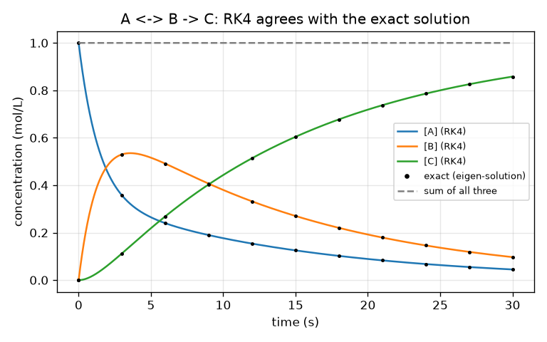
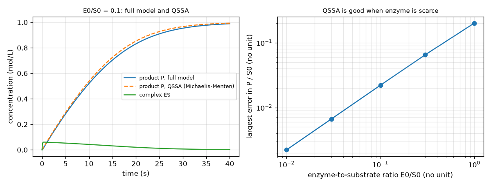
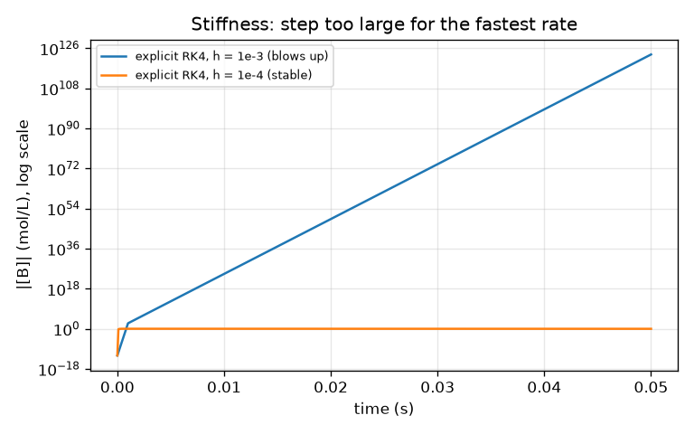

# Session 3: Reaction networks as ODEs, and when they bite back

*Level 3 (simulation and validation) · about 90 minutes · openreactionrate*

> This is a simplified educational model. It is not a validated design tool and must not be used for real structures, electrical installations, vehicles, industrial processes or medical decisions.

**Prerequisites**

- Session 1: A -> B and k.
- Session 2: rate laws and catalysts.
- Matrix times vector (explained in Section B).

**Learning objectives.** After this session you can:

- Write a reaction network as dc/dt = S r(c) with a stoichiometry matrix S and solve it with your own RK4.
- Validate the solver against an exact first-order solution and check that the conserved sums stay constant.
- Compare the quasi-steady-state (Michaelis-Menten) approximation with the full enzyme cycle and see how the error depends on the enzyme-to-substrate ratio.
- Find the rate-determining step of a chain, and recognise stiffness and the failure of an explicit step that is too large.

## A. Real-world problem
In a real flask many steps happen together: A turns into B, B can turn back, B turns into C; an enzyme grabs a substrate, lets it go or turns it into product. Which step limits how much product you get after a given time? Does a catalyst help if you put it on the wrong step? And what happens to a computer simulation when one step is ten thousand times faster than another? (Simplified teaching models; not for designing a real process.)

## B. Concept and theory
Collect the concentrations of all species in a vector c. Each reaction j has a rate r_j(c) (for example k [A] for a first-order step, or k1 [E][S] for a binding step). The stoichiometry matrix S has one row per species and one column per reaction: S[i, j] is how many molecules of species i are made (+) or used (-) each time reaction j happens once. Then dc/dt = S r(c), the whole network in one equation. To solve it we step in time with Runge-Kutta 4 (RK4): four slope evaluations per step, error shrinking like h to the fourth power. For first-order networks the equation is linear, dc/dt = K c, and the exact answer c(t) = V exp(L t) V^(-1) c0 follows from the eigenvalues of K, which gives a trusted reference. Quantities that every reaction leaves alone are conserved (for E + S <-> ES -> E + P: E + ES and S + ES + P); they make a good test of the code. If there is little enzyme compared with substrate the complex ES stays almost constant after a short start, and the cycle collapses to the Michaelis-Menten rate v = Vmax [S] / (Km + [S]) with Vmax = k2 E0 and Km = (km1 + k2) / k1 (the quasi-steady-state approximation, QSSA). In a chain the slowest step is the bottleneck. Finally, when rate constants differ by a factor of 10000, the system is stiff: an explicit solver needs a step h with h times the fastest rate below about 2.8, however smooth the answer looks, and above that it blows up; an implicit method (backward Euler) stays stable for any step.

| Symbol | Meaning | Unit |
|---|---|---|
| c | vector of concentrations | mol/L |
| r(c) | vector of reaction rates | mol/(L s) |
| S | stoichiometry matrix (species by reactions) | no unit |
| K | rate matrix of a first-order network, dc/dt = K c | 1/s |
| h | time step of the solver | s |
| k1, km1, k2 | binding, unbinding and product-forming rate constants of the enzyme cycle | L/(mol s), 1/s, 1/s |
| E0, S0 | total enzyme and starting substrate | mol/L |
| Vmax, Km | Michaelis-Menten maximum rate and constant | mol/(L s), mol/L |

**Assumptions**

- Mass-action rates at one fixed temperature in a well-stirred, closed vessel.
- Rate constants are made-up round numbers chosen to show the ideas, not data for a real enzyme.
- Fixed-step solvers (no error control) so that the failure of a too large step is visible.
- No heat effects and no volume change.

$$ \frac{d\mathbf c}{dt}=S\,\mathbf r(\mathbf c) $$

$$ \mathbf c_{n+1}=\mathbf c_n+\frac h6\left(\mathbf k_1+2\mathbf k_2+2\mathbf k_3+\mathbf k_4\right)\quad(\text{RK4}) $$

$$ v=\frac{V_{\max}[S]}{K_m+[S]},\qquad V_{\max}=k_2E_0,\qquad K_m=\frac{k_{-1}+k_2}{k_1} $$

$$ [E]+[ES]=E_0,\qquad [S]+[ES]+[P]=S_0 $$

$$ \text{explicit RK4 is stable only if }h\,k_{\text{fast}}\lesssim 2.8;\qquad (I-hK)\,\mathbf c_{n+1}=\mathbf c_n\ \ (\text{backward Euler}) $$

## C. Visual explanation
The first figure shows A <-> B -> C solved by RK4 (lines) and by the exact eigen-solution (dots): they coincide, the largest difference is about 7e-12 mol/L, and the sum of the three concentrations stays 1. The second figure shows the enzyme cycle at E0/S0 = 0.1: the full-model product curve and the QSSA curve nearly overlap, and the complex ES rises quickly and then stays nearly constant. Next to it, the log-log plot of the largest QSSA error against E0/S0 is almost a straight line: about 0.002 of S0 at a ratio of 0.01 and 0.2 of S0 at a ratio of 1, so the approximation is good only when enzyme is scarce. The third figure shows the failure case: with h = 1e-3 the explicit RK4 solution of the stiff system blows up by many orders of magnitude, while h = 1e-4 is stable.

*A <-> B -> C: RK4 (lines) against the exact eigen-solution (dots) and the sum of the three species (dashed).*

*Left: full enzyme model against the Michaelis-Menten approximation at E0/S0 = 0.1. Right: the error grows with the enzyme-to-substrate ratio.*

*Failure case: explicit RK4 with h = 1e-3 blows up on the stiff system; h = 1e-4 is stable.*

## D. Interactive simulation
Run the lesson (`python start.py 3`), then open the live app: [Session 3: A <-> B -> C with a catalyst](https://krunalpanchal1995.github.io/openreactionrate/session-03/) (or `app.html` in this folder). Move the catalyst slider and the rate constants: the bottleneck arrow is drawn thick, and the graph shows C with the catalyst (green) and without it (red dashed). Compare the readout of the RK4 value of C with the exact formula.

**Challenge.** Make the yield of C at 10 s at least 0.8 mol/L.

## E. Worked example and experiment
**Problem.** For the enzyme cycle with k1 = 10 L/(mol s), km1 = 5 1/s, k2 = 1 1/s and E0 = 0.1 mol/L, find Km and Vmax and the Michaelis-Menten rate at S = 1.0 mol/L. Then compare with the full model.

1. Km = (km1 + k2) / k1 = (5 + 1) / 10 = 0.6 mol/L.
2. Vmax = k2 E0 = 1 * 0.1 = 0.1 mol/(L s).
3. v(S = 1.0) = Vmax S / (Km + S) = 0.1 * 1.0 / 1.6 = 0.0625 mol/(L s). At S = Km the rate would be Vmax / 2 = 0.05.
4. Run the full four-species RK4 (h = 0.005 s). At t = 1 s the model has S = 0.8837 mol/L and ES = 0.05967 mol/L, so the true product rate k2 [ES] = 0.05967 mol/(L s).
5. The QSSA rate at that same S is 0.1 * 0.8837 / (0.6 + 0.8837) = 0.05956 mol/(L s), within 0.2 percent of the full model. The conserved sums E + ES = 0.1 and S + ES + P = 1.0 hold to 1e-14.

**Answer.** Km = 0.6 mol/L, Vmax = 0.1 mol/(L s), v(1.0) = 0.0625 mol/(L s); at 1 s the full model gives 0.05967 and the QSSA 0.05956 mol/(L s), and both conserved sums stay constant.

**Experiment.** The enzyme catalase in a raw potato or in liver breaks down hydrogen peroxide (3 percent drugstore solution) into water and oxygen: drop equal pieces into equal amounts of peroxide, measure the height of the foam after 30 s, and change the amount of peroxide (use eye protection, ask a teacher). More substrate gives more foam but flattens off: the saturation of Vmax S / (Km + S). Model versus experiment: foam height is an indirect measure, the enzyme is slowly damaged by the reaction, and temperature changes. The QSSA holds only when there is little enzyme compared with substrate, which is why the numbers differ from a textbook curve.

## Real-world application and mini-project: Which step should the catalyst speed up?
A plant makes D in a chain A -> B -> C -> D with rate constants 0.8, 0.05 and 0.6 per second, starting from 1 mol/L of A and no B, C or D. After 10 s the yield of D is only about 0.295 mol/L. The chemist can make exactly one step faster with a catalyst. Using `chain_yield` and `speed_up_one` from Session 3, find which single step to speed up so that the yield of D after 10 s doubles, and the smallest speed-up factor (searching up to 1000 times) that does it. General education only: real catalyst choice needs experiments and safety review.

**Deliverable:** A script that prints, for each of the three steps, the yield of D at 10 s for speed-ups of 2, 3, 5, 10, 100 and 1000 times, uses bisection on the factor to find the smallest speed-up that doubles the yield (or reports that none exists up to 1000 times), converts the winner to an activation-energy drop at 300 K with dEa = R T ln(factor), and saves a plot of D against time for the base case and the doubled case.

**Success looks like:** Step 2 (the slowest one) is reported as the only step that can do it, with a smallest factor of about 2.62 (a drop of about 2.4 kJ/mol at 300 K) giving a yield of about 0.59; steps 1 and 3 stay below 0.36 even when made 1000 times faster.

## F. Assessment and design challenge
**Question type A: Conceptual.** Why is it useful that the sum of the concentrations (or E + ES and S + ES + P) stays constant in a simulation? What would it tell you if one drifted?

Hint

Think about atoms that cannot be created or destroyed, and about numerical mistakes.

Step-by-step solution

Reactions only rearrange the same atoms, so these sums must not change; they are built into the structure of S (every column of S for A <-> B -> C sums to zero). In a simulation they give a free test: if a sum drifts, there is a bug in the rate equations or S, or the step is too large and the numerical error is big. Passing the test does not prove that the rates are right, but failing it proves something is wrong.

**Question type B: Numerical.** For E0/S0 = 0.1 and 1.0 the largest QSSA error in the product is 0.022 and 0.201 times S0. For which ratio would you trust the Michaelis-Menten equation to within 1 percent of S0? How can you check without running the full model?

Hint

Look at the trend: the error grows about in proportion to E0/S0. A rule of thumb is E0 much smaller than S0 + Km.

Step-by-step solution

The error is roughly 0.2 times the ratio, so under 1 percent of S0 needs a ratio of about 0.04 or less (the lesson gives 0.0067 at 0.03 and 0.0022 at 0.01). A quick rule without the full model: the approximation needs E0 much smaller than S0 + Km (here 1.6 mol/L), which is why E0 = 0.1 mol/L works well and E0 = 1.0 mol/L does not.

**Question type C: Graph and simulation interpretation.** On the stiffness graph, explicit RK4 with h = 1e-3 blows up and h = 1e-4 does not. Explain the numbers using the fastest rate constant 10000 1/s and the limit h k of about 2.8.

Hint

Compute h times k_fast for both steps.

Step-by-step solution

For h = 1e-3: h k = 10, above the stability limit 2.8, so every step multiplies the error by a factor larger than one and it explodes (overflow to infinity). For h = 1e-4: h k = 1, below the limit, so it is stable. The true solution is smooth after a few ten-thousandths of a second; the step must be small only to keep the fast, already finished, step stable.

**Question type D: Design and optimisation challenge.** Design: in the chain A -> B -> C -> D with k = 0.8, 0.05 and 0.6 1/s a catalyst can speed up only one step. You want the yield of D at 10 s to at least double (0.295 to 0.59 mol/L). Which step, and what factor? Why can the other two steps not do it?

Hint

Use chain_yield and speed_up_one for each step with a list of factors, then bisection on the best step.

Step-by-step solution

Step 2 (k = 0.05, the slowest, the rate-determining step) with a factor of about 2.62 gives a yield of 0.59. Speeding step 1 or step 3 by 1000 times gives only 0.339 and 0.353: those steps are not the bottleneck and the product is limited by the slow step in the middle, so the yield cannot reach 0.59 whatever you do to them. A 2.62 times faster step 2 corresponds to a drop of about R T ln 2.62 = 2.4 kJ/mol in activation energy at 300 K. Trade-off: the faster step 2 drains B into C; then step 3 (and reverse reactions in real systems) will become the next limit.

Score yourself with [RUBRIC.md](../../RUBRIC.md). Print the [activity sheet](activity_sheet.md) to work on paper.

## Common misconceptions
| Common misconception | What is actually true |
|---|---|
| Speeding up any step speeds up the whole chain. | Only the rate-determining step controls the throughput; making a fast step faster gives almost nothing. |
| If my simulation does not blow up, the answer is right. | A stable solver can still be inaccurate; validate against an exact solution and the conserved sums. |
| A smaller step is always a free improvement. | It costs time: for the stiff system explicit RK4 needs 10000 to 20000 steps to reach 2 s, while backward Euler needs 40 (less accurate, but stable). |
| The Michaelis-Menten equation is exact. | It is an approximation, good when enzyme is scarce compared with substrate; at E0/S0 = 1 the product is off by up to 20 percent of S0 in our example. |
| Stiffness means the answer changes fast all the time. | A stiff system has a very fast part that dies out quickly and a slow part that matters; the fast part forces tiny steps for an explicit solver even after it is gone. |

## Glossary
- **stoichiometry matrix**: matrix whose entry (i, j) says how many molecules of species i reaction j makes (+) or uses (-)
- **RK4**: a fourth-order Runge-Kutta method for solving differential equations step by step
- **conserved quantity**: a sum of concentrations that no reaction changes
- **quasi-steady state**: the approximation that an intermediate stays nearly constant, which leads to the Michaelis-Menten rate
- **rate-determining step**: the slowest step in a chain, which limits the overall rate
- **stiff system**: a system with very different time scales, which forces tiny steps on explicit solvers
- **backward Euler**: an implicit step that solves for the new state; stable for any step size

## Finish
1. Do the three coding tasks in [exercises.md](exercises.md).
2. Run `python start.py 3` again after your changes. It ends with the checkpoint; when it prints `PASS`, you are done. (Checkpoint only: `python start.py check 3`.)

Next: the [roadmap](../../promo/roadmap.md). Session 4 is yours to build.
